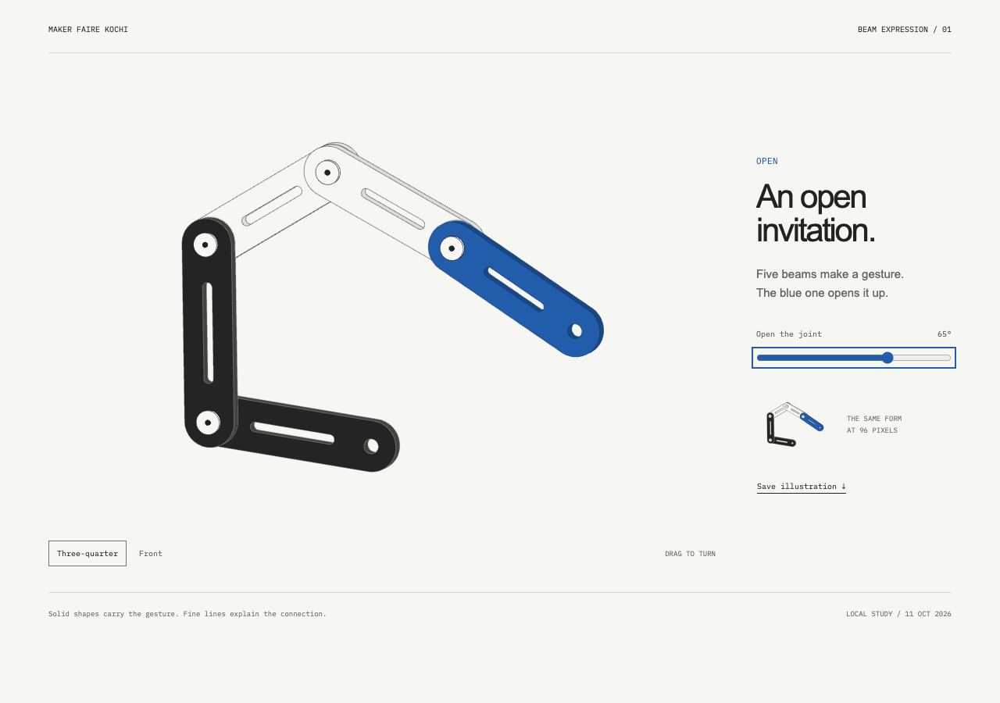
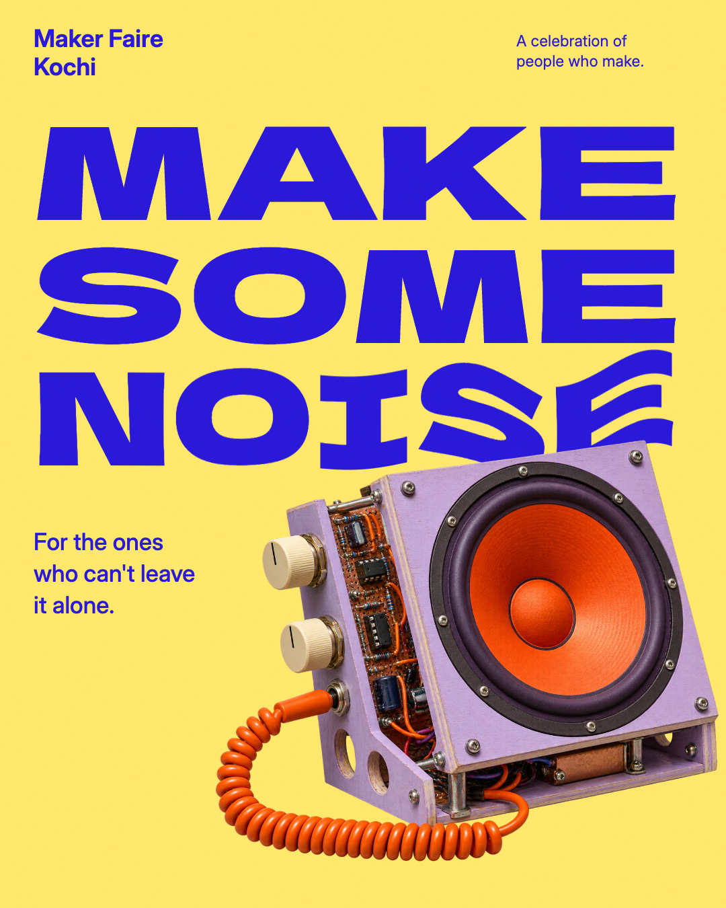
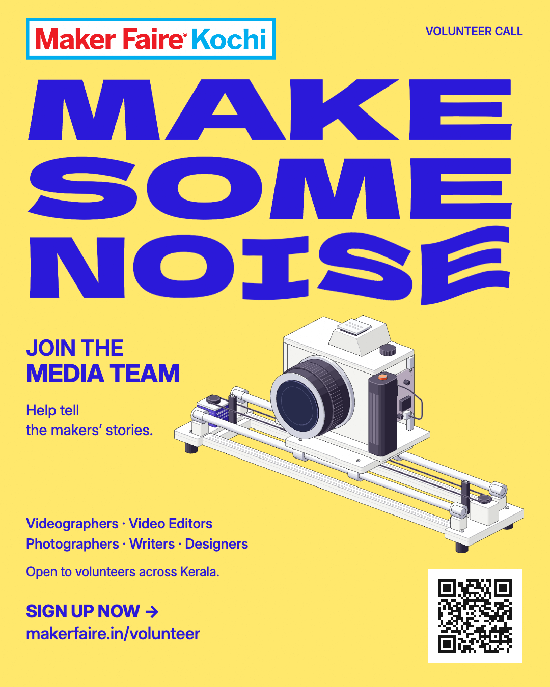
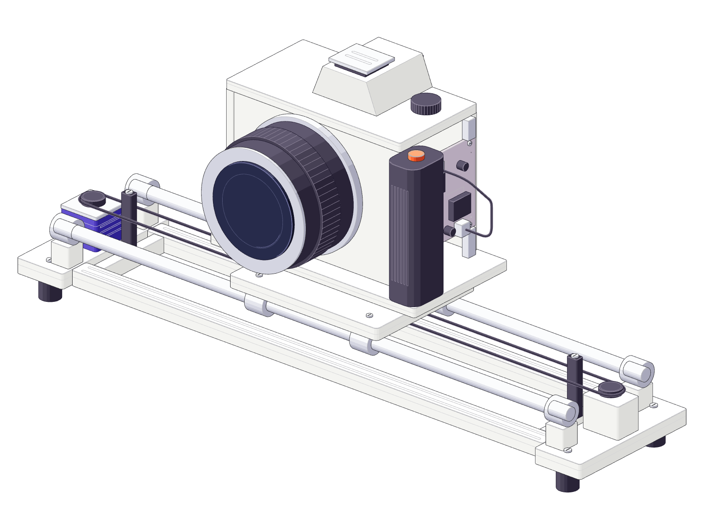
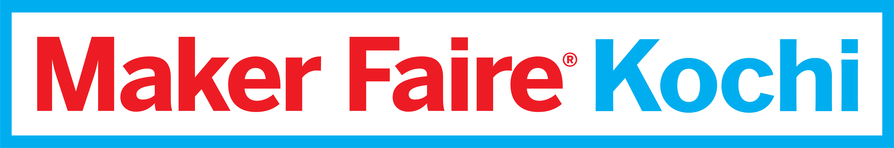

# Visual references

A small selection from the existing local work. These files are unchanged copies. [The manifest](manifest.json) records each original local path and SHA-256 checksum. See [creative guidelines](../docs/creative-guidelines.md) for scope and [research/credits](../docs/research-and-credits.md) for attribution.

## Illustration baseline

The restored straight-beam Open study is the working starting point for this illustration language. It remains an exploration, not a final approved identity. Curved playful beams and the Shared Bench extension were rejected.

[Baseline palette](illustration/beam-palette.json).

## Selected campaign — Loud Design / Make Some Noise

The user selected the original yellow/blue campaign style for continuation. Broad Dela Gothic One lettering and Inter support one controlled signal deformation in NOISE. The speaker image is a generated conceptual object; [its prompt](campaign/noisemaker-prompt.txt) is retained.

[Original formal moodboard](campaign/make-some-noise-moodboard.png) · [Campaign fonts and OFL licenses](campaign/fonts/).

## Media-team adaptation

This adaptation follows the same campaign language and introduces an original camera/slider illustration. The brief makes all five roles, Kerala-wide eligibility and signup explicit. Treat the copy and link verification as dated source records before a new release.

[9:16 story reference](campaign/media-team-story.png).

## Machine detail

Conceptual camera/slider geometry built with Anatomy, accompanied by its [MIT license](licenses/LICENSE.anatomy.txt). The SVG is included as an inspectable reference without the full rendering toolkit.

[Vector reference](illustration/camera-slider.svg).

## Supplied brand asset

[Logo source and rights record](brand/logo-source.json). Preserve original colors, proportions and the white interior.

## Historical material

The wider archive is indexed in [the local study inventory](../docs/local-workspace-inventory.md). The Open Workshop palette and Bricolage type foundations are explicitly historical in [the token snapshot](../brand-guidelines/tokens.json). The unrelated Zine identity and full experiments remain local, outside this reference set.
